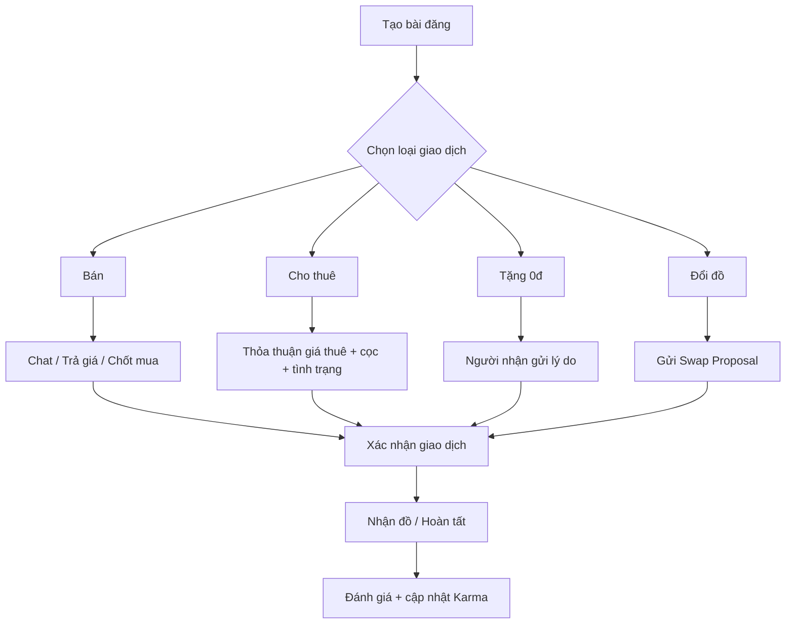

# TÀI LIỆU ĐẶC TẢ YÊU CẦU PHẦN MỀM (SRS)
## DỰ ÁN: CAMPUS MARKETPLACE
### Nền tảng Thương mại điện tử & Trao đổi đồ dùng nội bộ dành cho Sinh viên

| Thông tin tài liệu | Chi tiết |
|---|---|
| Tên dự án | Campus Marketplace |
| Phiên bản | 1.0.0 |
| Trạng thái | Dự thảo hoàn chỉnh |
| Đối tượng áp dụng | Product Owner, Business Analyst, UI/UX, Frontend, Backend, Mobile, QA/QC, Admin/Moderator |

---

## 1. GIỚI THIỆU (INTRODUCTION)

### 1.1 Mục đích (Purpose)

Campus Marketplace là nền tảng thương mại điện tử nội bộ dành cho sinh viên, tập trung vào mô hình giao dịch ngang hàng (Peer-to-Peer) trong phạm vi trường đại học, cơ sở và ký túc xá.

Hệ thống nhằm giải quyết nhu cầu mua, bán, cho thuê, tặng và đổi các vật dụng học tập, giáo trình, thiết bị công nghệ, đồ dùng phòng trọ và vật dụng chuyên ngành với chi phí phù hợp sinh viên.

Các mục tiêu chính:
- Tạo môi trường giao dịch khép kín, ưu tiên người dùng đã xác thực danh tính sinh viên.
- Hỗ trợ 4 mô hình giao dịch: **Bán (Sell), Cho thuê (Rent), Tặng (Giveaway), Đổi đồ (Swap)**.
- Tạo cơ chế tín nhiệm thông qua đánh giá hai chiều và **Campus Karma**.
- Hỗ trợ kết nối người mua và người bán trong cùng trường/campus/KTX.
- Giảm chi phí mua sắm và khuyến khích tái sử dụng đồ dùng giữa các khóa sinh viên.

### 1.2 Đối tượng hệ thống (Audience)

- **Sinh viên bán/cho/tặng/đổi (Seller / Giver / Swapper):** đăng bài, giao dịch và quản lý các món đồ của mình.
- **Sinh viên mua/thuê (Buyer / Renter):** tìm kiếm, trao đổi, mua hoặc thuê đồ.
- **Campus Moderator:** kiểm duyệt nội dung, xử lý báo cáo và tranh chấp trong phạm vi trường.
- **Super Admin:** quản lý toàn hệ thống, trường đại học, phân quyền và cấu hình nền tảng.
- **Đội ngũ phát triển và QA/QC:** sử dụng SRS làm cơ sở triển khai và kiểm thử.

---

## 2. PHẠM VI HỆ THỐNG (SYSTEM SCOPE)

### 2.1 Phạm vi chức năng

Hệ thống bao gồm:
- Đăng ký/đăng nhập và xác thực danh tính sinh viên.
- Quản lý hồ sơ Campus Profile.
- Đăng và quản lý bài đăng.
- Danh mục sản phẩm dành riêng cho nhu cầu sinh viên.
- Tìm kiếm và lọc theo môn học, mã học phần, giá và hình thức giao dịch.
- Giao dịch **Sell / Rent / Giveaway / Swap**.
- Nhắn tin P2P realtime.
- Cảnh báo hành vi/từ khóa có dấu hiệu gian lận trong chat.
- Đánh giá hai chiều và tính điểm Campus Karma.
- Báo cáo bài đăng/người dùng và xử lý khiếu nại.
- Quản trị trường, campus, KTX và điểm hẹn an toàn.
- Kiểm duyệt nội dung tự động và thủ công.

### 2.2 Phạm vi chưa triển khai trong MVP

Các chức năng sau được xác định là hướng mở rộng:
- Campus Locker.
- Escrow/giữ cọc tự động qua ví hoặc cổng thanh toán.
- Mở rộng danh mục sang tìm bạn cùng phòng và sang nhượng hợp đồng phòng trọ.
- Mở rộng hệ thống tới nhiều trường đại học trên toàn quốc.

### 2.3 Đối tượng giao dịch

Các nhóm sản phẩm chính:
1. Giáo trình & tài liệu.
2. Thiết bị công nghệ & học tập.
3. Đồ dùng phòng trọ & gia dụng.
4. Dụng cụ thực hành/chuyên ngành.
5. Thời trang & phụ kiện.
6. Góc trao yêu thương – sản phẩm 0đ.

---

## 3. TÍNH NĂNG CHÍNH (SYSTEM FEATURES)

### 3.1 Chức năng sinh viên

- Đăng ký bằng Google Workspace SSO/email trường hoặc phương án email cá nhân + thẻ sinh viên khi cần.
- Xác thực OTP qua email trường.
- Quản lý Campus Profile.
- Đăng bài bằng 1–6 ảnh hoặc video tối đa 15 giây.
- Chọn loại giao dịch: Bán, Thuê, Tặng, Đổi.
- Tìm kiếm và lọc bài đăng.
- Chat trực tiếp với người đăng.
- Gửi đề xuất giá hoặc đề xuất đổi đồ.
- Theo dõi trạng thái bài đăng/giao dịch.
- Đánh giá đối phương sau giao dịch.
- Xem Campus Karma và lịch sử đánh giá.
- Báo cáo bài đăng/người dùng.

### 3.2 Chức năng Sell

- Người bán thiết lập giá.
- Người mua có thể chốt mua hoặc trả giá.
- Hai bên trao đổi qua chat.
- Xác nhận giao dịch hoàn tất.
- Cập nhật đánh giá và Campus Karma.

### 3.3 Chức năng Rent

- Thiết lập giá thuê theo ngày hoặc kỳ.
- Thiết lập tiền cọc.
- Ghi nhận tình trạng tài sản trước khi bàn giao bằng hình ảnh.
- Quản lý thời gian thuê và trạng thái hợp đồng.
- Hỗ trợ xử lý tranh chấp khi có vấn đề về tài sản/cọc.

### 3.4 Chức năng Giveaway

- Đăng sản phẩm miễn phí.
- Người nhận gửi lời nhắn ngắn về lý do cần sản phẩm.
- Người tặng lựa chọn người nhận.
- Hoàn tất trao tặng và cộng điểm tín nhiệm.

### 3.5 Chức năng Swap

- Người đăng mô tả món đồ muốn đổi.
- Người dùng chọn một bài đăng của mình để đề xuất đổi.
- Có thể thỏa thuận bù trừ tiền.
- Hai bên xác nhận đề xuất trước khi giao dịch.

### 3.6 Chức năng quản trị

- Quản lý trường, campus, KTX và điểm hẹn.
- Kiểm duyệt bài đăng/người dùng.
- Quản lý blacklist.
- Xem bằng chứng chat/hình ảnh khi xử lý tranh chấp.
- Quản lý báo cáo và khiếu nại.
- Quản lý trạng thái tài khoản và quyền truy cập.

---

## 4. YÊU CẦU CHỨC NĂNG (FUNCTIONAL REQUIREMENTS)

| ID | Tên chức năng | Mô tả | Vai trò | Input | Output |
|---|---|---|---|---|---|
| FR-AUTH-01 | Đăng ký/Đăng nhập | Xác thực bằng email trường/SSO hoặc email cá nhân + thẻ SV | Student | Email, OTP, thông tin SV | Tài khoản xác thực |
| FR-AUTH-02 | Campus Profile | Quản lý trường, khoa, khóa, campus/KTX, Karma | Student | Thông tin hồ sơ | Hồ sơ sinh viên |
| FR-AUTH-03 | Bảo vệ dữ liệu | Ẩn email, MSSV và số điện thoại theo quyền truy cập | Student/System | Dữ liệu cá nhân | Dữ liệu đã che giấu |
| FR-LIST-01 | Quản lý danh mục | Cung cấp danh mục phù hợp sinh viên | Student/Admin | Category | Danh mục |
| FR-LIST-02 | Tạo bài đăng | Đăng 1–6 ảnh/video ≤15s và chọn loại giao dịch | Student | Nội dung, media, giá | Listing |
| FR-LIST-03 | Lifecycle bài đăng | Draft → Active → Reserved → Completed → Archived/Deleted | Student/System | Listing status | Trạng thái mới |
| FR-LIST-04 | Tìm kiếm & lọc | Lọc môn học/mã học phần, giá, loại giao dịch | Student | Từ khóa/bộ lọc | Danh sách bài đăng |
| FR-SELL-01 | Bán | Chốt giá hoặc trả giá | Buyer/Seller | Giá, offer | Thỏa thuận giao dịch |
| FR-RENT-01 | Cho thuê | Giá thuê, thời gian, cọc, tình trạng tài sản | Renter/Owner | Điều khoản thuê | Rental Contract |
| FR-GIVE-01 | Tặng | Người nhận gửi lý do và người tặng lựa chọn | Giver/Receiver | Lời nhắn | Người nhận được chọn |
| FR-SWAP-01 | Đề xuất đổi | Gửi bài đăng muốn đổi và tiền bù trừ nếu có | Swapper | Listing + cash adjustment | Swap Proposal |
| FR-CHAT-01 | Chat realtime | Trao đổi trực tiếp theo bài đăng | Student | Text/Image/Offer | Message realtime |
| FR-CHAT-02 | Anti-fraud Shield | Cảnh báo từ khóa có dấu hiệu gian lận | System | Nội dung chat | Cảnh báo |
| FR-REP-01 | Đánh giá 2 chiều | Đánh giá 1–5 sao và tag | Buyer/Seller/Renter/Giver | Rating, comment, tags | Review |
| FR-REP-02 | Campus Karma | Cộng/trừ điểm theo xác thực và giao dịch | System | Sự kiện giao dịch | Karma score |
| FR-REP-03 | Báo cáo | Báo cáo bài đăng/người dùng | Student/Moderator | Lý do + bằng chứng | Report |
| FR-ADM-01 | Kiểm duyệt | Tự động và thủ công theo blacklist/nội dung | Moderator/Admin | Listing/User | Kết quả moderation |
| FR-ADM-02 | Quản trị Campus | Quản lý trường, campus, KTX, điểm hẹn | Admin | Dữ liệu địa điểm | Cấu hình hệ thống |
| FR-ADM-03 | Tranh chấp | Kiểm tra chat/hình ảnh và xử lý khiếu nại | Moderator/Admin | Report/Evidence | Quyết định xử lý |

### 4.1 Quy tắc Campus Karma

- Xác thực email Edu: **+20 điểm**.
- Xác thực thêm CCCD/thẻ SV: **+15 điểm**.
- Giao dịch thành công với đánh giá 5 sao: **+5 điểm**.
- Tặng đồ thành công: **+10 điểm**.
- Bị báo cáo bom hẹn vô cớ: **-15 điểm**.
- Bị tố giác lừa đảo có minh chứng và được kiểm duyệt: **khóa tài khoản vĩnh viễn**.

### 4.2 Trạng thái bài đăng

`Draft → Active → Reserved → Completed → Archived/Deleted`

### 4.3 Luồng giao dịch tổng quát



---

## 5. YÊU CẦU PHI CHỨC NĂNG (NON-FUNCTIONAL REQUIREMENTS)

### 5.1 Hiệu năng

- Thời gian phản hồi trang/danh sách bài đăng: **< 1,5 giây** trong điều kiện mạng 4G/Wi-Fi thông thường.
- Độ trễ tin nhắn realtime: **< 300ms**.
- Hỗ trợ tối thiểu **15.000 người dùng đồng thời (CCU)** trong các đợt cao điểm.

### 5.2 Bảo mật & quyền riêng tư

- Tuân thủ **Nghị định 13/2023/NĐ-CP** về bảo vệ dữ liệu cá nhân.
- Kết nối sử dụng HTTPS/TLS 1.3.
- Mật khẩu mã hóa một chiều bằng Bcrypt/Argon2.
- Dữ liệu nhạy cảm trong DB được mã hóa ở cấp ứng dụng bằng AES-256.
- Rate limiting chống spam/bot.
- Phòng chống CSRF.
- Phòng chống SQL Injection.
- Sanitize nội dung để hạn chế XSS.
- Ẩn dữ liệu nhạy cảm của sinh viên theo quyền truy cập.

### 5.3 Khả dụng & mở rộng

- Mục tiêu uptime: **99,5% trong khung 06:00–24:00**.
- Kiến trúc Modular Monolith hoặc Microservices nhẹ.
- Có khả năng mở rộng từ một cụm trường lên mô hình liên trường.

### 5.4 UX/UI

- Mobile-first responsive.
- Tối ưu quy trình đăng bài: chụp ảnh → chọn giá/loại giao dịch → đăng.
- Giao diện trẻ trung, năng động, tối giản thao tác.
- Hỗ trợ Dark Mode.

---

## 6. KIẾN TRÚC HỆ THỐNG (SYSTEM ARCHITECTURE)

### 6.1 Kiến trúc tổng thể

```text
+------------------------------+
| Web / PWA / Mobile App       |
| Student + Moderator + Admin  |
+--------------+---------------+
               |
               v
+------------------------------+
| API / Application Layer      |
| Auth | Listing | Transaction |
| Chat | Review | Moderation   |
+--------------+---------------+
       |        |        |
       v        v        v
 PostgreSQL   Redis   Meilisearch
       |
       +-------------------+
       | Object Storage    |
       | Cloudinary/S3/R2  |
       +-------------------+

Realtime: Socket.io / WebSockets + Redis Pub/Sub
```

### 6.2 Công nghệ đề xuất

| Tầng | Công nghệ |
|---|---|
| Frontend Web/PWA | Next.js (React 19) + TailwindCSS |
| Mobile | React Native hoặc Flutter |
| Backend | Node.js (NestJS) hoặc Go |
| Realtime | Socket.io/WebSockets + Redis Pub/Sub |
| Database | PostgreSQL |
| Cache/Queue | Redis |
| Search | Meilisearch |
| Object Storage | Cloudinary / AWS S3 / Cloudflare R2 |

### 6.3 Authentication

- Google Workspace SSO cho domain trường.
- OTP qua email trường.
- Email cá nhân + ảnh thẻ sinh viên và OCR/Admin duyệt cho trường hợp chưa có email trường.

---

## 7. TESTING & QA

> Phần này được xây dựng từ các yêu cầu chức năng và phi chức năng trong tài liệu Campus Marketplace; tài liệu nguồn chưa cung cấp test case chi tiết.

### 7.1 Functional Test

Các nhóm cần kiểm thử:
- Đăng ký/đăng nhập và xác thực.
- Cập nhật Campus Profile.
- Tạo/sửa/xóa bài đăng.
- Tìm kiếm và lọc.
- Bán, thuê, tặng và đổi.
- Chat và gửi hình ảnh.
- Review và Campus Karma.
- Report và moderation.
- Xử lý tranh chấp.

### 7.2 Integration Test

Kiểm thử các luồng xuyên suốt:
- Đăng ký → xác thực → tạo hồ sơ → đăng bài.
- Listing → chat → chốt giao dịch → hoàn tất → review.
- Rental → hợp đồng → bàn giao → trả đồ → xử lý tranh chấp.
- Swap → gửi proposal → chấp nhận → hoàn tất giao dịch.
- Report → moderator → xem bằng chứng → xử lý.

### 7.3 Performance Test

- Kiểm tra thời gian tải danh sách bài đăng < 1,5 giây.
- Kiểm tra độ trễ chat < 300ms.
- Kiểm tra tải tối thiểu 15.000 CCU.

### 7.4 Security Test

- Kiểm thử SQL Injection.
- XSS.
- CSRF.
- Rate limiting.
- Brute-force đăng nhập.
- Kiểm tra phân quyền giữa Student, Moderator và Super Admin.
- Kiểm tra khả năng truy cập trái phép vào email, MSSV, số điện thoại và dữ liệu giao dịch.

---

## 8. TÍCH HỢP HỆ THỐNG (INTEGRATIONS)

### 8.1 Xác thực & định danh

- Google Workspace SSO.
- Email OTP.
- OCR thẻ sinh viên.
- Quy trình Admin duyệt đối với tài khoản cần xác minh thủ công.

### 8.2 Realtime Communication

- Socket.io/WebSockets.
- Redis Pub/Sub.

### 8.3 Search

- Meilisearch cho tìm kiếm toàn văn và tìm kiếm mờ.

### 8.4 Media Storage

- Cloudinary hoặc AWS S3/Cloudflare R2.
- Tối ưu ảnh/video trước khi lưu trữ.

### 8.5 Thanh toán – giai đoạn mở rộng

Theo roadmap, hệ thống có thể tích hợp:
- MoMo.
- ZaloPay.
- Viettel Money.

Mục đích chính trong giai đoạn mở rộng là hỗ trợ giữ cọc/escrow cho Rental.

### 8.6 Campus Locker – giai đoạn mở rộng

Campus Locker được định hướng là điểm giao nhận đồ tại sảnh KTX, giúp người dùng giao nhận mà không nhất thiết phải gặp trực tiếp.

---

## 9. CÁC YẾU TỐ NGOẠI (EXTERNAL FACTORS)

- Quy định pháp luật về bảo vệ dữ liệu cá nhân tại Việt Nam.
- Chính sách và quy định của từng trường đại học.
- Khả năng xác thực email sinh viên của từng trường.
- Trường hợp trường chưa có email sinh viên cần cơ chế xác minh thẻ SV/OCR và duyệt thủ công.
- Hành vi gian lận trong giao dịch P2P.
- Các nội dung bị cấm hoặc vi phạm quy định của nền tảng.
- Điều kiện mạng 4G/Wi-Fi tại ký túc xá.
- Nhu cầu giao dịch tăng mạnh vào đầu năm học, cuối kỳ thi và thời điểm sinh viên chuyển/dọn trọ.
- Việc mở rộng liên trường đòi hỏi quản lý dữ liệu theo từng trường/campus.

---

## 10. SƠ ĐỒ SƠ BỘ (SYSTEM DIAGRAMS)

### 10.1 Use Case Diagram

```text
                    +----------------------+
                    |   Campus Marketplace |
                    +----------+-----------+
                               |
       +-----------------------+-----------------------+
       |                       |                       |
       v                       v                       v
   Student                 Moderator              Super Admin
       |                       |                       |
       |-- Register/Login      |-- Moderate           |-- Manage Universities
       |-- Campus Profile      |-- Reports            |-- Manage Campuses
       |-- Browse/Search       |-- Disputes            |-- Manage Roles
       |-- Create Listing      |-- Evidence Review     |-- System Config
       |-- Sell/Rent/Give/Swap |
       |-- Chat                |
       |-- Review/Karma        |
       |-- Report              |
```

### 10.2 Data Flow Diagram (DFD)

**Level 0**

```text
Student
   |
   v
[Campus Marketplace]
   |
   +--> Authentication / Campus Identity
   +--> Listing & Search
   +--> Transaction
   +--> Chat
   +--> Review & Karma
   +--> Report / Moderation
   |
   v
Listing / Transaction / Notification / Profile Information
```

**Level 1**

```text
[1. Auth]
Student -> SSO/OTP/OCR -> User Profile

[2. Listing]
Student -> Create/Edit Listing -> PostgreSQL + Object Storage
User -> Search/Filter -> Meilisearch -> Listing Results

[3. Transaction]
Buyer/Renter/Giver/Swapper -> Offer/Proposal -> Transaction State
Transaction -> Completed -> Review/Karma

[4. Chat]
User <-> WebSocket/Socket.io <-> Redis Pub/Sub <-> User

[5. Moderation]
User -> Report -> Moderator/Admin -> Evidence Review -> Resolution
```

### 10.3 Entity Relationship Diagram (ERD)

```text
Universities 1 --- * Campuses
Universities 1 --- * Users
Campuses 1 --- * Users
Users 1 --- * Listings
Categories 1 --- * Listings
Listings 1 --- * ListingImages
Listings 1 --- * SwapProposals
Listings 1 --- * RentalContracts
Users 1 --- * Reviews
Users 1 --- * ChatRooms
ChatRooms 1 --- * Messages
Users 1 --- * Reports
Listings 1 --- * Reports
```

**Các bảng chính:**

- `Users`: id, email, fullName, phone, avatarUrl, universityId, campusId, dormitory, studentCardVerified, karmaScore, status, createdAt.
- `Universities`: id, name, shortName, emailDomains.
- `Campuses`: id, universityId, name, location.
- `Categories`: id, name, slug, icon, parentId.
- `Listings`: id, userId, categoryId, title, description, price, type, condition, rentalTerms, swapTarget, status.
- `ListingImages`: id, listingId, mediaUrl, mediaType.
- `SwapProposals`: id, initiatorListingId, targetListingId, cashAdjustment, status.
- `RentalContracts`: id, listingId, renterId, ownerId, startDate, endDate, totalRentAmount, depositAmount, proofImages, status.
- `ChatRooms`: id, listingId, senderId, receiverId.
- `Messages`: id, chatRoomId, senderId, content, type, isRead.
- `Reviews`: id, transactionId, reviewerId, targetUserId, rating, comment, tags.
- `Reports`: id, reporterId, targetUserId/targetListingId, reason, evidence, status.

---

## 11. KẾT LUẬN

Campus Marketplace được thiết kế như một nền tảng giao dịch nội bộ dành cho sinh viên, tập trung vào phạm vi trường đại học, campus và ký túc xá.

Hệ thống kết hợp:
- **Xác thực danh tính sinh viên** để xây dựng môi trường giao dịch có mức độ tin cậy cao hơn.
- **4 mô hình giao dịch** gồm Bán, Cho thuê, Tặng và Đổi.
- **Realtime Chat** để hai bên trao đổi và thống nhất giao dịch.
- **Campus Karma và đánh giá hai chiều** để hình thành hệ thống tín nhiệm.
- **Moderation và Report** để hỗ trợ xử lý nội dung vi phạm, gian lận và tranh chấp.
- **Kiến trúc có khả năng mở rộng** từ một cụm trường lên mô hình liên trường.

Roadmap được chia thành 3 giai đoạn:
1. **MVP (Tháng 1–3):** xác thực sinh viên, Sell/Giveaway, chat, điểm hẹn và đánh giá.
2. **Tăng trưởng (Tháng 4–6):** Swap, Rental, OCR và gamification.
3. **Mở rộng (Tháng 7+):** Campus Locker, thanh toán/escrow và các dịch vụ liên quan đến nhà ở sinh viên.
