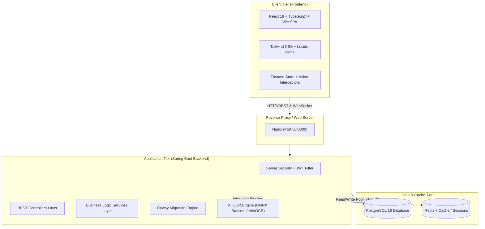

# 🎓 Campus Marketplace - Nền Tảng Thương Mại Điện Tử & Trao Đổi Đồ Dùng Nội Bộ Sinh Viên

> **Campus Marketplace** là giải pháp P2P thương mại điện tử chuyên biệt khép kín dành cho sinh viên **Trường Đại học Phenikaa (Phenikaa University)**. Nền tảng giải quyết bài toán lãng phí giáo trình, thiết bị học tập và đồ dùng phòng trọ; tối ưu chi phí học tập thông qua môi trường giao dịch an toàn, minh bạch với điểm tín nhiệm **Campus Karma** và công nghệ **AI OCR xác minh thẻ sinh viên chính chủ**.

---

## 📌 Bảng Mục Lục
- [1. Tính Năng Cốt Lõi (Core Features)](#1-tính-năng-cốt-lõi-core-features)
  - [1.1 4 Hình Thức Giao Dịch Chuyên Biệt](#11-4-hình-thức-giao-dịch-chuyên-biệt)
  - [1.2 Hệ Thống AI OCR Xác Thực Thẻ Sinh Viên](#12-hệ-thống-ai-ocr-xác-thực-thẻ-sinh-viên)
  - [1.3 An Toàn & Phòng Chống Gian Lận (Anti-Fraud)](#13-an-toàn--phòng-chống-gian-lận-anti-fraud)
  - [1.4 Quản Trị Hệ Thống (Admin Dashboard)](#14-quản-trị-hệ-thống-admin-dashboard)
- [2. Kiến Trúc Hệ Thống (System Architecture)](#2-kiến-trúc-hệ-thống-system-architecture)
- [3. Công Nghệ Sử Dụng (Tech Stack)](#3-công-nghệ-sử-dụng-tech-stack)
- [4. Cấu Trúc Thư Mục Dự Án (Directory Structure)](#4-cấu-trúc-thư-mục-dự-án-directory-structure)
- [5. Hướng Dẫn Cài Đặt & Khởi Chạy (Getting Started)](#5-hướng-dẫn-cài-đặt--khởi-chạy-getting-started)
- [6. API Documentation](#6-api-documentation)
- [7. Tác Giả & Liên Hệ (Authors)](#7-tác-giả--liên-hệ-authors)

---

## 1. Tính Năng Cốt Lõi (Core Features)

### 1.1 4 Hình Thức Giao Dịch Chuyên Biệt
1. **Bán Thanh Lý (SELL)**: Thu hồi vốn sinh viên cho giáo trình, máy tính Casio, đồ công nghệ, đồ gia dụng phòng trọ. Hỗ trợ giỏ hàng, đặt cọc giữ chỗ và xác nhận bàn giao an toàn.
2. **Cho Thuê Ngắn Hạn (RENT)**:
   - Tính phí thuê linh hoạt theo ngày kèm tiền cọc bảo đảm (hoàn lại 100% khi trả máy).
   - Bộ chọn ngày thuê trực quan `dd/mm/yyyy`, chặn chọn ngày quá khứ.
   - **Quy trình bàn giao 4 bước tuần tự**: Bắt buộc chụp tối thiểu 2-4 ảnh đối chiếu hiện trạng thiết bị trước khi giao đồ, hiển thị giờ hẹn và điểm hẹn có camera an toàn.
3. **Tặng Miễn Phí 0đ (GIVEAWAY)**:
   - Sinh viên có nhu cầu điền đơn đăng ký lý do nhận đồ.
   - Người tặng chủ động xét duyệt và chọn người nhận phù hợp nhất.
   - Tự động gửi thông báo hệ thống đến người được nhận và thông báo an ủi đến các bạn chưa may mắn.
4. **Trao Đổi Đồ (SWAP)**:
   - Giao lưu đồ dùng học tập ngang giá hoặc thương lượng bù trừ tiền chênh lệch.
   - Hệ thống quản lý đề xuất đổi đồ độc lập (Chấp thuận / Từ chối).

---

### 1.2 Hệ Thống AI OCR Xác Thực Thẻ Sinh Viên
- **Huấn luyện chuyên biệt theo phôi thẻ Trường Đại học Phenikaa**:
  - Nhận diện dải cam dọc thương hiệu `PHENIKAA - UNI ★★★★`.
  - Nhận diện logo xoáy tròn và tiêu đề `PHENIKAA UNIVERSITY`.
  - Bóc tách Họ tên, MSSV (8 số), Ngày sinh, Ngành học, Khoa, Khóa học và Niên khóa.
  - Đối soát chéo mã vạch Barcode và mã QR khớp 100% với MSSV nhằm chống giả mạo Photoshop.
- **Tốc độ suy luận siêu tốc (< 800ms)**: Sử dụng kiến trúc MobileNetV3 + BiLSTM + CTC Loss xuất sang ONNX Runtime FP16.
- **Kích hoạt tức thì**: Cấp huy hiệu Tích Xanh sinh viên chính chủ và thưởng `+15 Campus Karma`.

---

### 1.3 An Toàn & Phòng Chống Gian Lận (Anti-Fraud)
- **100% Kiểm duyệt bởi Quản trị viên**: Loại bỏ cơ chế duyệt tự động, mọi tin đăng mới đều ở trạng thái `PENDING_APPROVAL` để Admin đối soát trước khi hiển thị công khai.
- **Bộ lọc từ khóa cấm & Chế tài 3 gậy (3-Strikes System)**: Quét từ khóa vi phạm (lừa đảo, cọc ngoài, chất kích thích,...). Vi phạm 3 lần sẽ tự động khóa tài khoản.
- **Điểm hẹn an toàn có Camera (Safe Meeting Points)**: Tích hợp các vị trí có bảo vệ và camera giám sát tại Đại học Phenikaa (Sảnh Tòa A2, Thư viện, Căn tin, Ký túc xá).
- **Đánh giá 2 chiều phong cách Shopee**: Chấm điểm sao, tag đánh giá thực tế và kèm ảnh minh chứng sau khi hoàn tất giao dịch.

---

### 1.4 Quản Trị Hệ Thống (Admin Dashboard)
- **Thống kê KPIs thời gian thực**: Tổng số tin đăng, giao dịch hoàn tất, số sinh viên đã xác minh thẻ và tỷ lệ giải quyết tranh chấp.
- **Hàng đợi duyệt tin (Queue)**: Xem xét hình ảnh, nội dung, giá cả và bấm Duyệt bài / Từ chối (kèm lý do gửi đến hộp thư sinh viên).
- **Quản lý sinh viên & Tích xanh**: Kiểm tra hồ sơ thẻ sinh viên, cấp tích xanh và khóa/mở khóa tài khoản vi phạm.
- **Xử lý báo cáo vi phạm & Tranh chấp hợp đồng**: Xem ảnh đối chiếu hiện trạng thiết bị, phân xử hoàn cọc công bằng.

---

## 2. Kiến Trúc Hệ Thống (System Architecture)



---

## 3. Công Nghệ Sử Dụng (Tech Stack)

| Tầng công nghệ | Công nghệ / Thư viện chính | Ghi chú |
|---|---|---|
| **Frontend** | React 18, TypeScript, Vite, Tailwind CSS | Single Page Application (SPA) |
| **State & Networking** | Zustand, Axios, Socket.io-client, React Hook Form, Zod | Quản lý state gọn nhẹ, type-safe validation |
| **Backend** | Spring Boot 3.3.4, Java 17 | Kiến trúc phân tầng Controller - Service - Repository |
| **Security** | Spring Security 6, JJWT 0.12.5 | Xác thực JWT Stateless, mã hóa mật khẩu BCrypt |
| **Database & ORM** | PostgreSQL 16, Spring Data JPA, Hibernate, HikariCP | Hỗ trợ full-text search tiếng Việt |
| **Database Migration** | Flyway 10.10 | Quản lý phiên bản CSDL tự động qua các script V1..V17 |
| **Caching** | Redis 7, Spring Data Redis | Cache phiên và dữ liệu truy vấn nhanh |
| **AI / Machine Learning** | Python, PyTorch, MobileNetV3 + BiLSTM + CTC, ONNX | Nhận diện phôi thẻ Phenikaa < 800ms |
| **DevOps & Containers** | Docker, Docker Compose, Nginx | Đóng gói môi trường đồng nhất một lệnh |

---

## 4. Cấu Trúc Thư Mục Dự Án (Directory Structure)

```text
CAMPUS MARKETPLACE/
├── code/
│   ├── ai_ocr/                          # Module AI OCR thẻ sinh viên Phenikaa
│   │   ├── phenikaa_ocr_pipeline.py     # Pipeline suy luận siêu tốc (< 800ms)
│   │   ├── train_phenikaa_model.py      # Kịch bản sinh dữ liệu và huấn luyện CRNN
│   │   └── README.md                    # Tài liệu kiến trúc mô hình AI
│   ├── backend/                         # Source code Spring Boot 3
│   │   ├── src/main/java/com/ioc/internship/
│   │   │   ├── controller/              # REST Endpoints (Student, Admin, Public)
│   │   │   ├── dto/                     # Data Transfer Objects (Request / Response)
│   │   │   ├── entity/                  # JPA Entities (User, Listing, Contract,...)
│   │   │   ├── repository/              # Spring Data JPA Repositories
│   │   │   └── service/                 # Business Services & Implementations
│   │   ├── src/main/resources/
│   │   │   ├── application.yml          # Cấu hình Spring Boot, Database, Mail
│   │   │   └── db/migration/            # Scripts Flyway Migration (V1 -> V17)
│   │   └── pom.xml                      # Maven dependencies
│   └── front end/                       # Source code React Vite SPA
│       ├── public/images/               # Ảnh mẫu thẻ SV Phenikaa & poster quy chuẩn
│       ├── src/
│       │   ├── components/              # Reusable UI & Feature Modals
│       │   ├── pages/                   # Trang giao diện chính (Auth, Listing, Rental, Admin, Chat)
│       │   ├── services/                # Axios API Services (Auth, Listing, Rental, OCR)
│       │   ├── store/                   # Zustand Global Stores
│       │   └── types/                   # TypeScript interfaces & types
│       └── package.json
├── docs/                                # Tài liệu dự án (SRS, ERD, Sprint Plan, Conventions)
├── docker-compose.yml                   # Cấu hình Docker Compose đa dịch vụ
└── README.md                            # Hướng dẫn dự án
```

---

## 5. Hướng Dẫn Cài Đặt & Khởi Chạy (Getting Started)

### 5.1 Yêu cầu tiên quyết (Prerequisites)
- **Java**: JDK 17 trở lên
- **Node.js**: v18.x trở lên & `npm`
- **PostgreSQL**: v15/16 (hoặc qua Docker)
- **Docker & Docker Compose** (Tùy chọn, khuyến nghị)

---

### 5.2 Cách 1: Khởi chạy nhanh bằng Docker Compose

```bash
# 1. Clone repository
git clone https://github.com/MinhPhuong292005/Campus-Marketplace.git
cd Campus-Marketplace

# 2. Khởi chạy toàn bộ hệ thống (PostgreSQL, Redis, Backend, Frontend)
docker compose up -d
```

- **Frontend**: `http://localhost:3000`
- **Backend API**: `http://localhost:8088/api/v1`
- **Swagger UI**: `http://localhost:8088/api/v1/swagger-ui.html`

---

### 5.3 Cách 2: Chạy thủ công trên môi trường cục bộ (Local Development)

#### 1. Khởi chạy Database & Cache:
```bash
docker compose up -d postgres redis
```

#### 2. Khởi chạy Backend (Spring Boot):
```bash
cd code/backend
mvn clean spring-boot:run
```
*Backend sẽ tự động chạy Flyway migration để khởi tạo các bảng và dữ liệu danh mục mẫu.*

#### 3. Khởi chạy Frontend (React Vite):
```bash
cd code/front\ end
npm install
npm run dev
```
*Truy cập trình duyệt tại `http://localhost:3000`*.

---

## 6. API Documentation

Swagger OpenAPI được tích hợp sẵn tại:
```text
http://localhost:8088/api/v1/swagger-ui.html
```

### Các nhóm API chính:
- **Auth**: `/api/v1/auth/register`, `/api/v1/auth/login`, `/api/v1/auth/send-otp`
- **Listings**: `/api/v1/student/listings` (CRUD, bộ lọc theo hình thức SELL/RENT/GIVEAWAY/SWAP)
- **Rental**: `/api/v1/student/rentals` (Hợp đồng thuê, đối chiếu ảnh bàn giao)
- **AI OCR**: `/api/v1/student/profile/ocr-verify` (Quét thẻ SV Phenikaa)
- **Reviews**: `/api/v1/student/reviews` (Đánh giá 2 chiều & cập nhật Karma)
- **Admin**: `/api/v1/admin/listings` (Duyệt/từ chối bài đăng), `/api/v1/admin/users` (Quản lý sinh viên)

---

## 7. Tác Giả & Liên Hệ (Authors)

- **Dự án**: Báo cáo Thực tập Tốt nghiệp IOC / Solo Project
- **Sinh viên thực hiện**: Nguyễn Minh Phương
- **Trường**: Đại học Phenikaa (Phenikaa University)
- **Vị trí**: Fullstack Developer (Backend + Frontend + AI OCR)
- **GitHub**: [@MinhPhuong292005](https://github.com/MinhPhuong292005)
- **Repository**: [https://github.com/MinhPhuong292005/Campus-Marketplace](https://github.com/MinhPhuong292005/Campus-Marketplace)

---
*Phát triển vì cộng đồng sinh viên Đại học Phenikaa – Giao dịch an toàn, tin cậy và tiết kiệm!* 🎓

