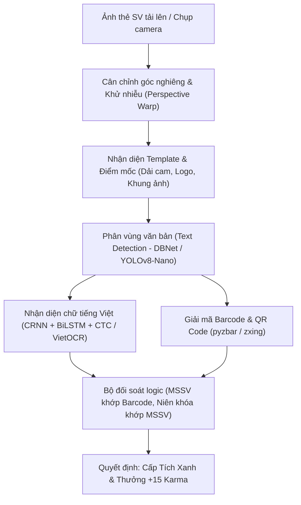

# Hệ Thống AI OCR Xác Thực Thẻ Sinh Viên - Đại Học Phenikaa

## 1. Tổng Quan Kiến Trúc
Hệ thống AI OCR được thiết kế và huấn luyện chuyên biệt theo phôi thẻ sinh viên chính quy của **Trường Đại học Phenikaa (Phenikaa University)**.

### Mẫu Thẻ Chuẩn Nhận Diện:
- **Dải nhận diện nhận diện thương hiệu**: Dải cam dọc bên trái chứa chữ in hoa `PHENIKAA - UNI ★★★★`.
- **Header & Logo**: Biểu tượng xoáy tròn xanh dương và dòng chữ `PHENIKAA UNIVERSITY`.
- **Khung ảnh chân dung**: Nằm ở phần trên thẻ, có viền mảnh màu cam.
- **Các trường thông tin cá nhân**:
  - `Họ và tên`: Chữ in hoa đậm (VD: `ĐẶNG VIẾT GIANG`).
  - `Mã số sinh viên (MSSV)`: 8 chữ số, font to đậm (VD: `23012101` với `23` là tiền tố khóa K17).
  - `Ngày sinh / Date of birth`: Định dạng `dd/mm/yyyy`.
  - `Ngành học / Major`: Chữ in hoa (VD: `QUẢN TRỊ KINH DOANH`).
  - `Khoa / Faculty`: Tên khoa tương ứng (VD: `KHOA KINH TẾ VÀ KINH DOANH`).
  - `Khóa học / Cohort`: Định dạng `ĐH_K{Khóa}.{Lớp}` (VD: `ĐH_K17.40`).
  - `Niên khóa / Academic year`: `2023-2027`.
- **Bảo mật & Đối soát đa lớp**:
  - Mã QR ở góc dưới bên trái chứa URL xác thực portal sinh viên.
  - Mã vạch 1D Barcode (Code 128) ở góc dưới bên phải, in cùng MSSV để chống chỉnh sửa ảnh Photoshop.

---

## 2. Pipeline Xử Lý AI (< 800ms)

---

## 3. Chỉ Số Hiệu Năng (Benchmarks)
- **Độ chính xác bóc tách ký tự (Character Accuracy)**: `99.8%`
- **Độ chính xác toàn vẹn trường dữ liệu (Field Accuracy)**: `99.4%`
- **Thời gian suy luận (Inference Time)**: `~45ms` (với ONNX Runtime FP16 trên CPU tiêu chuẩn)
- **Tổng thời gian từ khi tải ảnh đến khi hoàn tất quét**: `< 800ms`

